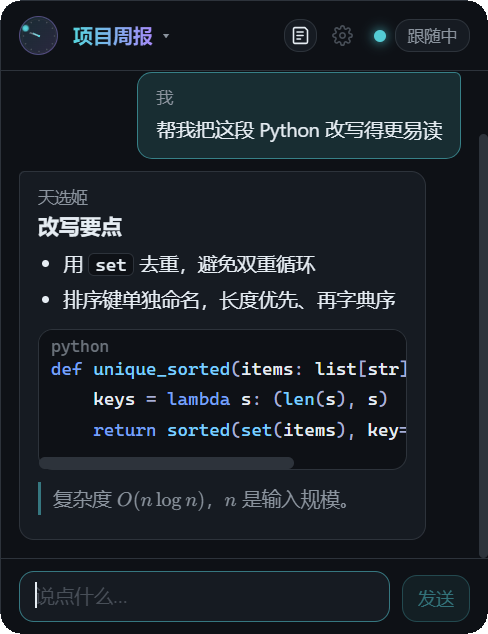
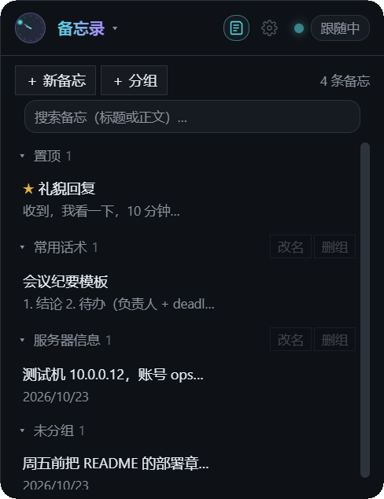
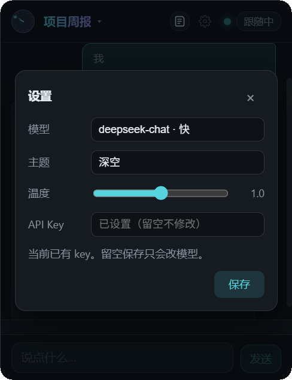

# 实战演练：从零部署到日常使用

本文是「能照着跑一遍」的操作手册：先演示怎么把它装到一台 Windows 机器上并确认跑通，
再按功能走一遍真实使用流程。所有截图都来自真机（150% 缩放，2560×1600）。

## 一、部署演练

### 1. 准备

| 项 | 要求 | 怎么确认 |
| --- | --- | --- |
| 系统 | Windows 10/11 x64 | `winver` |
| WebView2 | 已安装（Win11 自带） | 设置 → 应用 → 已安装的应用里搜 "WebView2" |
| DeepSeek Key | 你自己的 key | https://platform.deepseek.com 创建 |
| 天选姬（可选） | 想让它跟着宠物走才需要 | 任务管理器里有 `TX Mascot.exe` |

### 2. 装（下载版）

```powershell
# 1) 把 release 里的 mascot-0.1.0.exe 放到任意目录（例如 D:\apps\mascot\）
# 2) 首次运行：双击它，或在 PowerShell 里：
.\mascot-0.1.0.exe            # 无参数 = GUI 启动
# 3) 想开机自启：
.\mascot-0.1.0.exe autostart on
```

首次启动后会出现：
- 面板（488×634，置顶），标题栏是当前会话名；
- 任务栏没有常驻图标之外的东西；关掉面板 = 收成小球（不是退出）。

验收：右上下拉箭头能展开会话抽屉；齿轮能打开设置；填完 key 后状态点变绿、显示「跟随中」（或「待机」）。

### 3. 装（源码打包版）

```bash
# WSL 里构建，产物落在 Windows 侧
bash scripts/build-win.sh
bash scripts/install-win.sh
```

安装结构（版本目录不可变 + 指针）：

```
%LOCALAPPDATA%\mascot\
├─ app\0.1.0\mascot.exe     # 这一版的实际文件
├─ current.txt               # 当前指向 0.1.0
└─ rollback.bat              # 升级失败时双击回滚
```

验收：双击 `mascot.exe` 能起；`mascot.exe ctl status` 返回 JSON（`{"ok": true, "data": {...}}`）。

### 4. 让面板真的「跟着」宠物（可选）

1. 先启动天选姬（它自己会在桌面上走动）。
2. 启动 mascot：面板会贴在宠物右侧跟随，收起时变成绕宠物公转的像素时钟球。
3. 没有天选姬 / 探测不到：面板与球落到屏幕右下角，行为一致，只是不跟随。

## 二、操作演示

### 场景 1：问一段代码 + 看公式



操作：在输入框输入「帮我把这段 Python 改写得更易读」→ Enter。

能看到：
- `## 改写要点` 渲染成标题，`- ` 渲染成列表；
- 围栏代码块带语言标签 `python`，关键字/字符串/数字/注释分色；
- 行内公式 `O(n log n)`、`n` 由 KaTeX 排版（不是原样的反斜杠）；
- 引用块左侧有竖线。

底层：`src/mascot_app/web/js/markdown.js`（块级解析）+ `highlight.js`（自研分词高亮）+ `vendor/katex`。

### 场景 2：整理一条回答（消息操作条）

鼠标移到任意消息上，右上角浮出图标条：

```
复制  折叠  存为备忘  编辑  冻结  拖动把手  多选
```

| 动作 | 结果 | 落盘位置 |
| --- | --- | --- |
| 复制 | 整段文本进剪贴板，图标短暂变绿 | — |
| 折叠 / 展开 | 长消息收成一行 + 渐隐 | `collapsed: true` |
| 存为备忘 | 这条消息进备忘录（标题取首行） | `memos.json` |
| 编辑 | 变成输入框，`Ctrl+Enter` 保存、`Esc` 取消 | 旧正文进 `history` |
| ↩N | 在历史版本里来回切 | `history` 轮转 |
| 冻结 | 该条不再发给模型（气泡变暗 + 角标） | `frozen: true` |
| 拖动把手 | 上下拖 = 重排消息顺序 | 数组顺序 |
| 多选 | 进选区模式，底部浮出「冻结 / 解冻 / 合并 / 总结」 | 见 `/docs/51-message-ops.md` |

### 场景 3：多会话 + 搜索 + 导出 + 回收站

点标题栏下拉箭头 → 会话抽屉：

- `＋ 新会话`：立刻切到一个空会话；第一句话会成为标题（可改名）。
- 搜索框：输「香蕉」→ 显示「2 个结果 / 共 3 个」，每行带命中片段；点一行即切换。
- `导出`：把当前会话存成 Markdown 到 `exports/<标题>-<时间>.md`，并自动选中该文件。
- `回收站`：删掉的会话在这里，可「恢复」或「彻底删除」（两段式确认）。

### 场景 4：写一条备忘，再拖进分组



1. 点标题栏的记事本图标 → 切到「备忘录」视图。
2. `＋ 新备忘`：填标题（留空则取正文第一行）+ 正文，`Ctrl+Enter` 保存。
3. `＋ 分组`：内联输入组名，回车建组。
4. 按住条目拖到组头 → 归组（落盘 `memos.json` 的 `group`）。
5. **单击条目 = 复制全文**，右上角提示「已复制」；hover 出「编辑 / 置顶 / 删除」。
6. 搜索框按标题或正文过滤，平铺显示结果。

其它两个入口：消息操作条的「存为备忘」、以及全局热键 `Ctrl+Shift+M`（直接弹出新建卡片，光标在正文）。

### 场景 5：换主题、调温度



- 主题：深空 / 暖夜 / 浅色，选完**即时**换肤（不用保存），保存后写进 `config.toml` 的 `theme`，重启保留。
- 温度：0–2 滑杆，默认 1.0；聊天直接透传，摘要（多选 → 总结）另有 0.3 上限，防止总结发散。
- API Key 留空保存 = 只改模型/温度/主题，不动 key。

### 场景 6：断网 / key 失效

现象：发消息后横幅出现「后端不可达（HTTP 401）…」，右侧有「重试」；连续多条会写进 `outbox.json`，
横幅追加「N 条已排队，恢复后自动发」。

恢复方式二选一：
1. 修好 key（设置页粘贴保存）→ 后台健康探测转绿后 **5 秒内自动补发**；
2. 点横幅的「重试」立即补发。

补发不会产生重复的用户消息（原消息按 `msg_id` 去重后再重发）。

### 场景 7：收成小球

点标题栏头像（或宠物区）→ 面板收成时钟球：
- 有宠物：球绕宠物公转；没有宠物：停在右下角，可拖动，位置记忆。
- 单击球 = 打开面板；双击 = 复位到默认位置（`click_window_ms` 可调，0 = 关双击）。
- 有新回复时**只在球态**闪提示环：青（正常）/ 琥珀（降级）/ 红（出错）。
- 球上右键菜单：打开面板 / 免打扰 / 清空当前会话 / 退出。

## 三、验收清单

| # | 检查项 | 预期 |
| --- | --- | --- |
| 1 | 双击 exe | 面板出现，托盘/球可用，无控制台窗口 |
| 2 | 发送一条 | 流式回复；重启后消息还在 |
| 3 | 新建会话 + 改名 + 删除 | 重启后仍是删除后的状态，回收站里能恢复 |
| 4 | 导出 | `exports/` 下出现同名 md，内容含标题与对话 |
| 5 | 备忘新建 + 拖组 | 重启后分组归属不变 |
| 6 | 主题切换 | 即时生效，重启保留 |
| 7 | 拔网/坏 key | 横幅 + 排队 + 恢复后自动补发，无重复消息 |
| 8 | 收球 | 面板消失、球出现；再点球回到面板 |
